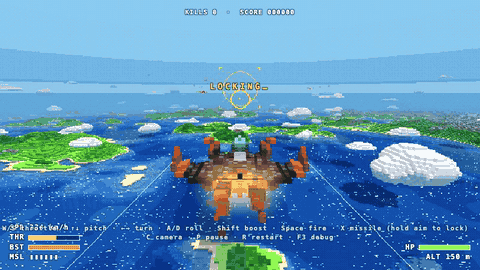

# Voxel Fighter

A fully 3D voxel air-combat game that runs in the browser (Three.js + TypeScript + Vite). No external assets: aircraft, islands, ocean, clouds and effects are all procedurally generated.



## Quick start

```
npm install
npm run dev     # http://localhost:5173
npm run build   # type-check + production build
```

## Features

- Real voxel geometry meshed with greedy meshing (one draw call per model, no per-voxel meshes)
- Pixel-art look: low-resolution render target upscaled with nearest filtering, 4x4 Bayer dither and color quantization
- Procedural terraced voxel islands, shader ocean with foam and cloud shadows, voxel clouds
- Arcade flight model with quaternion attitude, spring-damper chase camera (chase / far / free / cockpit)
- Enemy AI (cruise, chase, attack, evade), lead-shooting, swept bullet collision, aim assist
- **Homing missiles** with a lock-on sequence, smoke trails and splash damage
- Voxel exhaust flames, explosions, wingtip contrails, parachuting pilots
- Fixed 1/60 s physics step with render interpolation; keyboard and gamepad input

## Controls

| Key | Action |
| --- | --- |
| W / S | Throttle up / down |
| Arrow Up / Down | Pitch (inverted: Up = nose down; set `flight.invertPitch` in `src/config.ts`) |
| Arrow Left / Right | Turn |
| A / D | Roll |
| Shift | Boost |
| Space | Machine gun |
| X | Fire missile |
| C | Cycle camera (chase / far / free [drag to orbit] / cockpit) |
| P | Pause |
| R | Restart |
| F3 | Debug overlay |

**Missiles:** keep an enemy near the center of the screen. The reticle turns from yellow (`LOCKING`) to a blinking red `MISSILE LOCK` after about one second. A missile fired while locked homes in on the target; otherwise it flies straight. You carry 6 missiles and get one back every 6 seconds.

**Gamepad:** left stick = pitch/turn, right stick X = roll, RT/A = guns, X = missile, B/LT = boost, D-pad up/down = throttle, Y = camera, Start = pause, Back = restart.

## Tuning

- `src/config.ts` holds speeds, turn rates, camera spring constants, render resolution (`render.height`), and more.
- URL parameters: `?debug`, `?cam=far|free|cockpit`, `?pos=x,y,z&yaw=deg`, `?cfg=render.height=240,camera.freeDistance=30`

## Project layout

```
src/
  voxel/       VoxelModel, greedy mesher, palette, .vox loader
  entities/    fighter model, player flight, enemy AI, bullets, missiles, parachutists
  world/       terrain generator, chunked islands, ocean, clouds
  effects/     exhaust, explosions, contrails, particle pools
  rendering/   low-res pixel renderer, materials, sky, chase camera
  input/       keyboard / mouse / gamepad
  ui/          HUD
  game/        game loop and orchestration
```
